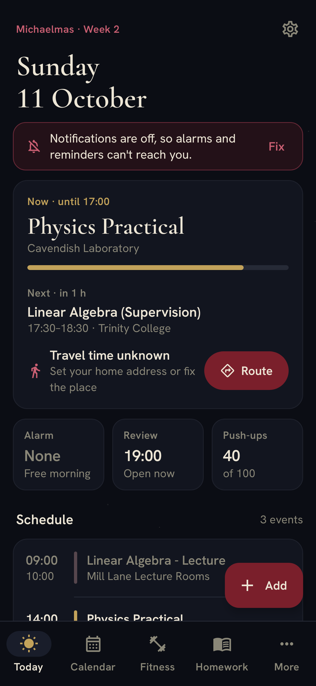

# Cam Planner

A personal planner for a Cambridge student: timetable, alarms, homework, reading and fitness in one
quiet, dark app. Single user, fully offline: no accounts, no backend, no API keys.



- **Today.** What is on now and next, when to leave and a Route button, tomorrow's alarm (tap to
  skip one morning), the evening review, push-ups so far, homework due soon and a first-run
  checklist.
- **Calendar.** A week strip (swipe or use the arrows, or jump to any date) and the day's agenda.
  Tap an event for details, travel mode, Route, edit or delete. Add events that happen once or
  repeat: every day, weekdays, weekly on chosen days or every two weeks, ending never, on a date or
  after a number of times. Edit or delete one occurrence or the whole series. Imported lectures can
  be moved, given another place or reminder, or cancelled for one week. Those changes survive a
  re-import, and "Back to the timetable's version" undoes them.
- **Undo everywhere.** Deleting an event, cancelling a lecture, logging push-ups, removing a set,
  deleting homework or a run, skipping an alarm: each shows a snackbar with Undo.
- **Fitness.** Push-ups and pull-ups with +5/+10/+20 or any amount (also taken off), the day's sets
  with × to remove one, quiet abs and legs exercises, runs with pace and a weekly target, rest days,
  a 14-day streak. Use the arrow to log for an earlier day.
- **Homework.** Reading pages per academic subject for today or yesterday, and homework with
  To do/Done, overdue work in red, a full editor and delete with Undo.
- **Alarms.** A full-screen morning alarm before the first event, with Snooze and Dismiss and a
  "Test the alarm" button. "Time to leave" alerts with Route, reminders (per event or the default),
  the evening review and a midday nudge with "+10" actions. Everything is recalculated on every
  change, after a reboot and on clock or time-zone changes.
- **Timetable import.** An `.ics` file (RRULE, EXDATE, RECURRENCE-ID and time zones via biweekly),
  from the Import page or "Open with Cam Planner". Subjects can be renamed, recoloured, merged and
  marked academic. Places are geocoded once and can be corrected.
- **Backup.** Settings › Save a backup writes everything to one file; Restore reads it back.

Travel time is the straight-line distance × 1.3 at 5 km/h walking or 15 km/h cycling, plus a buffer.

## Install on your phone

The debug build is `app/build/outputs/apk/debug/app-debug.apk` (about 22 MB, Android 8.0 or later).

**Without a computer**
1. Copy `app-debug.apk` to the phone, for example by downloading it or from Google Drive.
2. Open it from the Files app. Android asks you to allow installs from that app: go to
   *Settings › Install unknown apps*, allow it for Files (or your browser), then go back and tap
   *Install*.
3. Play Protect may warn that the app is from an unknown developer. Choose *Install anyway*; the app
   is signed with a debug key rather than a Play Store key.

**With a computer and USB**
1. On the phone, enable *Developer options* (tap *Build number* seven times), then *USB debugging*.
2. Run `adb install -r app/build/outputs/apk/debug/app-debug.apk`.

**First run**
1. *Alarms and notifications* opens. Allow notifications, exact alarms and full-screen alarms. Then
   open *Battery* and set Cam Planner to *Unrestricted* or *Don't optimise*, so alarms aren't delayed.
2. Follow the *Getting started* list on Today: import your `.ics` timetable, set your home address
   (*Settings › Home › Find*, or enter coordinates) and the Full Term dates.
3. In *More › Places*, fix any place the geocoder couldn't find. In *Settings*, tap *Test the alarm*
   to hear it ring in 10 seconds.

Looking places up needs a network connection once; everything else works offline. The Geocoder is
provided by Google Play services, so on a phone without them, enter coordinates by hand.

## Build

```bash
./gradlew test assembleDebug
```

You need JDK 17+ and the Android SDK (platform 37, build-tools 37). Gradle downloads everything else.

## Project layout

| Module | What lives there |
|---|---|
| `core:model` | Plain data types and the built-in exercise list |
| `core:domain` | Pure logic with unit tests: alarm planning, repeating events, travel estimates, Maps URLs, almanac (sun, moon, term weeks), streaks and statistics, evening review |
| `core:ics` | `.ics` import on biweekly, with tests for recurrence, exceptions and the Europe/London clock changes |
| `core:data` | Room database (with migrations), DataStore settings, repositories with undo, backup, geocoding worker |
| `core:alarms` | AlarmManager scheduling, receivers, ringing service, lock-screen alarm, permissions |
| `core:designsystem` | Colour and type tokens, bundled fonts (OFL), the component kit (headers, groups, rows, rings, steppers, chips, sheets) and moon glyphs |
| `app` | The single activity, navigation, ViewModels and screens |

The tests include an end-to-end smoke test (`AppSmokeTest`) on Robolectric. It imports a timetable,
schedules alarms, adds a weekly event, cancels a lecture and undoes it, logs push-ups and undoes
them, removes a set, edits homework and opens every page. It writes screenshots to
`app/build/smoke/`; the latest set is in `docs/screens/`.
